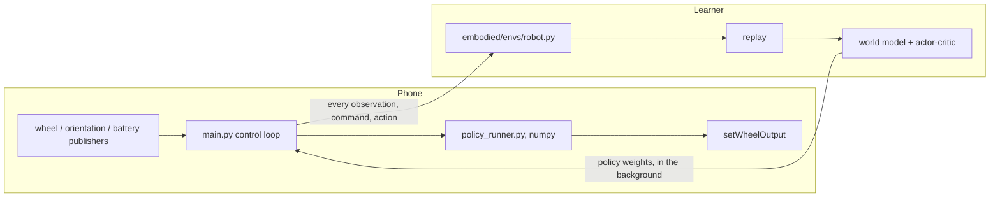

# DreamerV3 Bridge

`dreamerBridge` trains a DreamerV3 agent on the robot. The policy runs **on
the phone**; a learner on a GPU (a computer or a Slurm cluster, running the
[dreamerv3 repo](https://github.com/Alex-Vasilache/dreamerv3/tree/smartphone-robot-bridge))
receives every observation the phone records and pushes new policy weights
back every few seconds.

**To set up and run training, follow
[ROBOT.md](https://github.com/Alex-Vasilache/dreamerv3/blob/smartphone-robot-bridge/ROBOT.md)
in the dreamerv3 repo.** Its `tools/robot/train.sh` starts the learner,
points this app at it and launches the app. This page covers the app itself.

## Split Of Work



The phone owns the control clock (25, 50 or 100 Hz) and never waits on the
network: the action is computed in the same tick as the observation that
produced it. Until the first weights arrive the learner drives (the
bootstrap); after that the connection switches to onboard. Reward and episode
logic live on the learner, so changing the task does not mean rebuilding the
app.

## Pointing The App At A Learner

The address comes from `trainer.json` in the app's files directory, reread on
every connection attempt, so it can change without a rebuild:

```bash
adb push trainer.json /sdcard/Android/data/jp.oist.abcvlib.dreamerBridge/files/
```

```json
{"ip": "<learner address>", "port": 3000, "max_hz": 25, "no_base": false}
```

`max_hz` caps the control rate; `no_base: true` runs without the robot base
(no wheels, for testing the link) and is read only at app start. Without a
`trainer.json`, the address compiled from `config.json` at the repository root
(`BuildConfig.IP`/`PORT`, copy `config.template.json`) is used.

## Building

```bash
cp config.template.json config.json
./gradlew :dreamerBridge:assembleDebug
adb install -r apps/dreamerBridge/build/outputs/apk/debug/dreamerBridge-debug.apk
```

The module embeds Python 3.13 with numpy through Chaquopy, so it builds for
`arm64-v8a` and `x86_64` only. Gradle needs a full JDK 17+; with Android
Studio on macOS use
`JAVA_HOME="/Applications/Android Studio.app/Contents/jbr/Contents/Home"`.

## Screens

- **Training** (opens at start): reward, connection, control rate, the
  `policy` stamp of the weights in use.
- **Policy list** (Back from training): saved policies in
  `files/policies/*.npz` with a `.json` sidecar. Tap to run one without a
  learner, long-press to rename or delete. Each training run keeps its latest
  weights there under its name.
- **Web page** at `http://<phone WiFi address>:8080` (`webui.py`): a joystick
  that sets the command a command-following policy tracks, and a mirror of the
  screen.

## Code

| file | what |
|---|---|
| `src/main/python/main.py` | control loop, link to the learner, onboard and saved-policy modes |
| `src/main/python/policy_runner.py`, `numpy_policy.py` | the policy in numpy |
| `src/main/python/bridge_link.py` | framing and background weight receiving |
| `src/main/python/command.py` | the command (forward, turn) a policy follows |
| `src/main/python/webui.py`, `webpages/` | joystick / mirror web page |
| `src/main/java/.../MainActivity.kt` | Android wiring, USB, base health |
| `src/main/java/.../PickerActivity.kt`, `PlayerActivity.kt` | saved-policy list and player |

`policy_runner.py`, `numpy_policy.py` and `bridge_link.py` are verbatim copies
of `dreamerv3/deploy/` in the dreamerv3 repo; change them there and run
`tools/robot/dev/check_app_copies.sh --fix`.

Chaquopy exposes Kotlin *fields* but not getters/setters as attributes, and
cannot reach a `var` declared in an `object` at all; expose state through a
`@JvmStatic` method. These fail only on the phone, at runtime.

## Wire Format

One TCP connection, both directions framed the same way:

```text
[4 bytes big-endian: JSON header length][JSON header][blob_len bytes of payload]
```

The phone opens with `{"type": "hello", "protocol": 3, ...}`; the learner's
reply says whether the connection runs onboard and carries the reward
settings shown on screen. Weight pushes travel as blobs in 32 KB slices so
they never stall the control loop.
